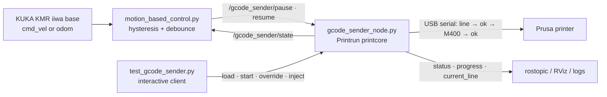

# Motion-Aware 3D Print Control for a Mobile Robot (ROS + Printrun)


A ROS 1 node that streams G-code to a **Prusa 3D printer over USB** with Printrun's `printcore`, built for **mobile additive manufacturing**: a printer carried by a **KUKA KMR iiwa** mobile manipulator.
Because the robot can move at any moment, the print has to **pause on demand, resume from the exact line, and accept G-code changes mid-print**. This repo is the controller that does that, plus a node that **pauses the print automatically while the robot base is moving**.

## Highlights

- **Line-level pause.** Every G-code line is followed by `M400`, and the next line is sent only after the printer replies `ok`. The firmware queue never runs ahead, so a pause takes effect after the current move instead of after a buffer of queued moves. The earlier version ([ROS_octoprint](https://github.com/greenaandblue/ROS_octoprint)) went through OctoPrint's REST API, and its pause / resume routines took ≈1.0 s / ≈2.4 s end to end.
- **Resume where you left off.** The sender keeps the line index, so it never restarts the file.
- **Edit the print while paused.** Preview the next N lines, **override** any upcoming line, or **inject** extra lines before it. Changes live in runtime tables, and the G-code file is never modified.
- **Motion-based auto pause.** `motion_based_control.py` watches the base velocity (`cmd_vel` or `odom`) and pauses or resumes through a hysteresis + debounce state machine. Every event is logged to CSV.
- **Live status.** Progress, current line, nozzle/bed temperature and XYZ position (polled with `M105`/`M114`) are published as ROS topics.

## Architecture



## Quick start

**Requirements:** Ubuntu 20.04 + ROS Noetic (`rospy`, `std_msgs`, `std_srvs`, `geometry_msgs`, `nav_msgs`), Python 3, `pip install printrun`, and a Prusa printer on USB (usually `/dev/ttyACM0`).

The current version lives in [`May18/final_version/`](May18/final_version/).

```bash
cd May18/final_version
# 1. set the serial port in printer_config.ini  (ls /dev/ttyACM*)

roscore                                              # terminal 1
python3 gcode_sender_node.py                         # terminal 2 (reads ./printer_config.ini)
python3 test_gcode_sender.py /path/to/part.gcode     # terminal 3: load → connect → start → interactive

# optional: auto pause / resume when the robot base moves
python3 motion_based_control.py --speed-source odom --threshold 0.04 --debounce 1.0
```

Interactive client commands:

| Key | Action | Key | Action |
|---|---|---|---|
| `p` | Pause | `v` | Preview upcoming lines (with overrides / injections) |
| `r` | Resume | `o` | Override one upcoming line |
| `s` | Stop | `j` | Inject lines before an upcoming line |
| `i` | Status | `co` / `cj` | Clear overrides / injections |
| `q` | Stop + disconnect + quit | | |

For the full lab procedure on the KUKA (network, SmartPad, slicing in PrusaSlicer), see [KUKA-printer_munual](https://github.com/greenaandblue/KUKA-printer_munual).

## ROS interface (`gcode_sender_node.py`)

**Services** (`std_srvs/Trigger`)

| Service | Description |
|---|---|
| `/gcode_sender/connect` · `/disconnect` | Open / close the serial connection |
| `/gcode_sender/start` | Start streaming the loaded file from line 0 (clears overrides and injections) |
| `/gcode_sender/pause` · `/resume` · `/stop` | Line-level flow control |
| `/gcode_sender/preview_upcoming` | Publish the next `preview_lines` lines to `/gcode_sender/upcoming_lines` |
| `/gcode_sender/clear_overrides` · `/clear_injections` | Drop pending edits |

**Subscribed topics** (`std_msgs/String`)

| Topic | Payload |
|---|---|
| `/gcode_sender/load_file` | Absolute path to a `.gcode` file |
| `/gcode_sender/override_line` | `{"index": 42, "replacement": "G1 X100 Y100 F3000"}` |
| `/gcode_sender/inject_before` | `{"index": 42, "lines": ["G1 Z5 F600", "G4 P500"]}` |

**Published topics**

| Topic | Type | Description |
|---|---|---|
| `/gcode_sender/state` | `String` | `IDLE` · `PRINTING` · `PAUSED` · `STOPPED` |
| `/gcode_sender/status` | `String` | Time, progress, line, XYZ, nozzle / bed temperature |
| `/gcode_sender/progress` | `Float32` | Percent complete |
| `/gcode_sender/current_line` | `Int32` | Index of the line being executed |
| `/gcode_sender/upcoming_lines` | `String` | Preview text (on request) |

Example from the command line:

```bash
rostopic pub -1 /gcode_sender/load_file std_msgs/String "data: '/home/user/part.gcode'"
rosservice call /gcode_sender/connect && rosservice call /gcode_sender/start
rosservice call /gcode_sender/pause
rostopic pub -1 /gcode_sender/inject_before std_msgs/String \
  "data: '{\"index\": 1200, \"lines\": [\"G1 Z5 F600\"]}'"
rosservice call /gcode_sender/resume
```

## Motion-based control (`motion_based_control.py`)

```
PRINTING ── speed > threshold + hysteresis for ≥ debounce ──▶ PAUSED   (calls /gcode_sender/pause)
PAUSED   ── speed ≤ threshold − hysteresis for ≥ debounce ──▶ PRINTING (calls /gcode_sender/resume)
IDLE / STOPPED from the sender ──▶ INACTIVE
```

| Option (CLI / ROS param) | Default | Description |
|---|---|---|
| `--speed-source` / `~speed_source` | `cmd_vel` | `cmd_vel` (`geometry_msgs/Twist`) or `odom` (`nav_msgs/Odometry`) |
| `--cmd-vel-topic` | `/kmriiwa/base/command/cmd_vel` | Velocity command topic |
| `--odom-topic` | `/kmriiwa/base/state/odom` | Odometry topic |
| `--threshold` | `0.04` m/s | Speed threshold |
| `--hysteresis` | `0.005` m/s | Dead band around the threshold |
| `--debounce` | `1.0` s | How long the condition must hold before switching |
| `--log-dir` | `./logs` | CSV event log (`motion_print_control_<timestamp>.csv`) |

It also publishes `/motion_control/state` and `/motion_control/robot_speed`.

`motion_based_control.py` is the newest controller, updated for the v4/v5 sender (handles the `STOPPED` state, uses a longer debounce to cover `M400` latency). The version used in the February robot tests is [`0227(YES)/motion_chinese.py`](<0227(YES)/motion_chinese.py>), and its CSV logs are in [`0227(YES)/logs/`](<0227(YES)/logs/>).

## Configuration (`printer_config.ini`)

```ini
[printer]
port = /dev/ttyACM0          ; changes when the USB cable is re-plugged
baud = 115200
status_update_interval = 10  ; seconds between M105/M114 status polls
preview_lines = 10           ; optional, lines returned by preview_upcoming
```

## Repository map

Development happened in dated folders (`MMDD`). `(YES)`/`(Y)` marks versions that worked and `(F)`/`FAIL` marks dead ends; they are kept as a record.

| Folder | What it contains |
|---|---|
| **`May18/final_version/`** | **Current version.** Sender v5 (override + inject), interactive client, motion-based control, usage guide |
| `0302(YES)/` | Print-quality tests: the KMR base drives back and forth while printing; stops automatically when the print finishes |
| `0227(YES)/` | Sender v4 + motion control with CSV logs from robot tests |
| `0224_imediatepause(YES)/` | Sender v4: line-by-line + `M400` for immediate pause |
| `0217_TimeEstimate/` | Firmware-buffer / pause-latency estimator (trapezoidal motion model) |
| `0217_immediatepause/` | Attempt using `M0` to flush the printer buffer on pause |
| `0212_MotionBasedControl(Y)/` | First working motion-based auto pause / resume |
| `0210_override(F)/` | Speed-override experiment (superseded by v5 override / inject) |
| `0209_node_improved(YES)/` | First reliable ROS sender with OctoPrint-style state handling |
| `0202_node/`, `0202_node_improved/` | First ROS node versions; standalone non-ROS sender; Chinese usage notes |
| `0120/`, `0202_scripts_FAIL/` | Early Printrun scripts (do not use) |
| `fail_override/`, `Feb20 recover files/`, `Feb23_single_send/` | Backup copies of the 0209 sender and empty placeholders |
| `printer_stl.py`, `printer_config.ini`, `default_profile.ini` (root) | Standalone (no ROS) tool: slices the STLs listed in `printer_config.ini` with the PrusaSlicer CLI and prints the result with Printrun |

## Related repositories

| Repo | Role |
|---|---|
| [ROS_octoprint](https://github.com/greenaandblue/ROS_octoprint) | Earlier approach through the OctoPrint REST API: pause-latency benchmarks, speed override |
| [KUKA-printer_munual](https://github.com/greenaandblue/KUKA-printer_munual) | Lab manual: KMR iiwa navigation + running this controller |
| [Octoprint](https://github.com/greenaandblue/Octoprint) | OctoPi / ROS setup notes |

## Safety

Pausing stops sending new commands; it does **not** stop a move that is already executing, and heaters stay on. Test with small files first, and keep the printer's physical reset / power switch within reach.

## Author

**Huihang Liu** · Computer Engineering, Penn State · [@greenaandblue](https://github.com/greenaandblue)
